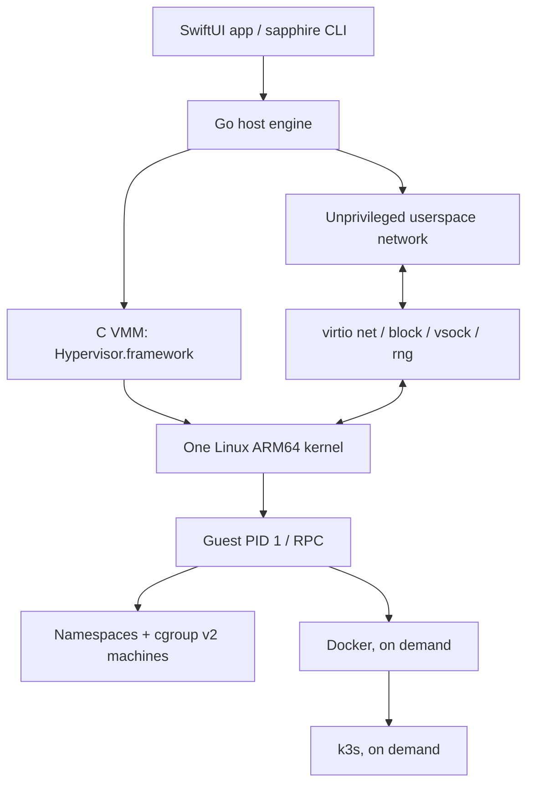

# Sapphire runtime

Sapphire is an independent, MIT-licensed implementation of a shared-kernel
Linux runtime for Apple Silicon. It uses Hypervisor.framework directly. The
implementation does not use Lima, QEMU, or Virtualization.framework to run its
VM. The minimum host version is macOS 15 because the VMM uses Apple's GIC API.

This is the same architectural mechanism observed in the inspected OrbStack
helper: a userspace VMM controlling Apple's hardware hypervisor, with Linux
services and lightweight machines sharing a kernel. It is not a claim that the
two implementations, device models, scheduling, memory management, or
performance are identical.

## Host

The C VMM boots an independently built Linux kernel and initramfs. Guest RAM is
an anonymous mapping; configuring a memory ceiling does not require touching
every page. Guest physical address and virtqueue accesses must be checked
against the mapped range before a host pointer is formed.

The host engine owns the VMM's lifetime, Unix control sockets, network stack,
Docker socket, and forwarders. A lifetime file lock prevents competing engines
from using one data directory. Docker operations always select Sapphire's
socket explicitly; installation does not select a global Docker context.

Network and control traffic are driven by readiness and events. Lifecycle
commands may use bounded retries while starting or stopping a service.
Persistent idle polling is not part of the design.
Published Docker ports come from one container-list snapshot after a relevant
event; the watcher does not inspect every container separately. Failed event
sessions use bounded exponential backoff. Opening a stream alone does not
reset recovery backoff; it must first remain healthy.

## Guest

Linux machines share the VM's kernel and network namespace. Namespaces separate
their process, mount, hostname, and IPC views. Cgroup v2 limits CPU and memory.
Sparse, separately mounted machine disks provide ordinary filesystem capacity
limits. A machine is not a second hardware VM and cannot select a different
kernel.

This initial machine mode trusts root. Machine root retains privileged
credentials in the guest's initial user namespace. Treat it as administrative
access to the shared Sapphire guest, including persistent storage and other
workloads. The current namespace/cgroup setup is not a security boundary
against machine root, and its ordinary resource limits are not tamper-resistant
against that administrator. Untrusted machine isolation requires a separately
implemented and tested credential, device, and namespace policy on both
startup and command execution.

Machine disks use direct loop I/O to avoid keeping a second buffered copy of
their contents in the outer guest filesystem. The agent checks the effective
kernel flags and backing-file identity; it refuses an unsupported buffered
fallback. Host disk images request macOS `F_NOCACHE`, with an explicit warning
if the request fails. Guest FLUSH and writable teardown retain `fsync`.
These cache policies still need throughput and latency comparisons.

Docker and k3s start only when requested. Kubernetes uses the same VM and
Docker engine rather than starting another hardware VM. Stopping Kubernetes
must stop its guest processes and host forwarding resources. Stopping the VM
must release its guest RAM and host services.

The initial transports are:

| Transport | Purpose |
| --- | --- |
| Host private `control.sock` | HTTP control API |
| Host private `docker.sock` | Docker API proxy |
| Guest vsock 1024 | One newline-delimited JSON RPC request/response |
| Guest vsock 1025 | Raw Docker Unix socket proxy |
| Guest vsock 1026 | Declared TCP connection, then byte stream |

The RPC envelope is `{"ok":true,"result":...,"error":""}`. A successful result
can be an object, array, string, or null. Errors must retain their meaning
through the guest, host, CLI, and app.

## Resource acceptance

Similar or lower resource consumption than OrbStack is a requirement, not an
inference from this architecture. Every low-level decision must account for
host and guest memory, CPU, wakeups, copying, disk allocation, and latency.

The VMM implements virtio-balloon free-page reporting. It takes only complete
host-aligned ranges from a guest report, removes their stage-2 mappings,
replaces the anonymous backing, and remaps them before returning the buffers
to Linux. Rounding inward matters when a 4 KiB guest runs on a 16 KiB host:
rounding outward would discard adjacent pages still in use.

Reporting returns allocator-free pages. It does not itself evict Linux's
filesystem page cache or establish a complete host-pressure policy. Those
behaviors must be profiled separately; unconditional cache drops would trade
away warm I/O performance and are not an acceptable substitute for measurement.

Demand-backed RAM helps initial allocation. It does **not** prove that pages
used and subsequently freed by Linux return to macOS. The reporting path
must be validated with a grow/free workload and actual host physical
footprint. A build without proven reclamation cannot meet that part of the
acceptance requirement.

The performance matrix and measurement limitations are in
[resource acceptance](resource-acceptance.md). No result should be described as
OrbStack parity until the matched measurements and functional checks pass.

Block requests currently execute synchronously under the device lock. A slow
disk operation can delay network, vsock, and lifecycle work. Disk scatter/gather
I/O, vsock copies, reclamation batching, and a host-pressure policy remain
performance work; a favorable idle footprint cannot establish their parity.

## Initial compatibility boundaries

Interactive machine PTYs, Rosetta, host directory sharing, macOS VMs,
different guest kernels, and complete OrbStack networking/filesystem
compatibility are not initial guarantees. Unsupported settings must produce a
clear error. No placeholder action should report a successful runtime change.
